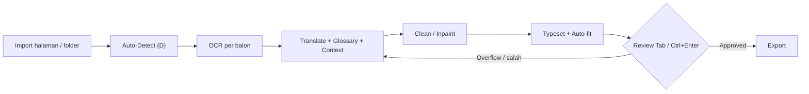

# YuchiDesain.md — Spesifikasi UI/UX & Arsitektur Komponen

> Aplikasi desktop penerjemah & typesetting manga (Tauri + React + Python backend).
> Basis visual: referensi "Chisa Translator v3.0" (dark studio, dual-canvas).
> Basis alur kerja: efisiensi produksi ala Mantra Engine — Deteksi/OCR → Terjemahan Kontekstual → Cleaning → Typesetting, tanpa pindah menu.

---

## 0. Prinsip Desain

1. **Satu layar, satu alur.** Semua tahap pipeline dikerjakan dari workspace yang sama; tidak ada dialog modal untuk pekerjaan rutin.
2. **Keyboard-first.** Setiap aksi berulang (pindah balon, konfirmasi, render, ganti halaman) punya pintasan.
3. **Status selalu terlihat.** Setiap balon dan halaman menampilkan tahap pipeline-nya lewat warna.
4. **Instan.** Pindah halaman ≤ 1 frame (thumbnail fallback + preload), preview teks ≤ 100 ms setelah ketikan berhenti.
5. **Non-destruktif.** Semua edit (teks, mask, healing) masuk history undo/redo; gambar sumber tidak pernah diubah.

---

## 1. Design Tokens & Tema Visual

### 1.1 Palet Warna — Dark Pro Studio

```css
:root {
  /* Surface */
  --bg-app:        #121214; /* latar utama / area kanvas */
  --bg-panel:      #18181B; /* toolbar, sidebar, inspector, status bar */
  --bg-elevated:   #1F1F23; /* input, accordion header, dropdown */
  --bg-hover:      #26262B;
  --bg-active:     #2E2E34;
  --border:        #27272A;
  --border-strong: #3F3F46;

  /* Teks */
  --text-primary:   #F4F4F5;
  --text-secondary: #A1A1AA;
  --text-muted:     #71717A;
  --text-disabled:  #52525B;

  /* Aksen */
  --accent:        #EF4444; /* bounding box aktif, status bar badge, tab aktif */
  --accent-hover:  #F87171;
  --accent-subtle: rgba(239, 68, 68, 0.12);
  --focus-ring:    rgba(239, 68, 68, 0.55);

  /* Semantik status balon */
  --status-raw:      #EF4444; /* Merah  — terdeteksi / raw OCR, belum diterjemahkan */
  --status-draft:    #EAB308; /* Kuning — draft terjemahan / sudah inpainted */
  --status-done:     #22C55E; /* Hijau  — typeset & approved */
  --status-error:    #F97316; /* Oranye — overflow / gagal OCR / gagal render */
  --status-excluded: #52525B; /* Abu    — dikecualikan (SFX/tidak diterjemahkan) */

  /* Overlay kanvas */
  --mask-overlay:  rgba(239, 68, 68, 0.35);
  --heal-brush:    rgba(59, 130, 246, 0.45);
  --selection-bg:  rgba(239, 68, 68, 0.08);
}
```

### 1.2 Tipografi UI

| Token | Font | Size / Line | Pemakaian |
|---|---|---|---|
| `--font-ui` | Inter, Geist, system-ui | — | Seluruh antarmuka |
| `--font-mono` | JetBrains Mono, Geist Mono, Consolas | — | Koordinat, badge nomor, zoom %, ID |
| `text-xs` | ui | 11 / 16 | Label section (UPPERCASE, tracking 0.06em) |
| `text-sm` | ui | 12 / 18 | Isi panel, input, tombol |
| `text-base` | ui | 13 / 20 | Textarea terjemahan |
| `text-lg` | ui | 15 / 22 | Judul empty state |
| `badge` | mono | 10 / 12, weight 700 | Nomor balon di kanvas |

### 1.3 Font Komik (Panel Typography)

Dikelompokkan di dropdown dengan preview live:

- **Dialog:** Wild Words, CC Wild Words, Anime Ace 2.0, Komika Text, Manga Temple
- **Teriakan / SFX:** Badaboom BB, CC Astro City, Komika Axis
- **Narasi / Caption:** CC Victory Speech, Blambot Classic
- **Bisikan / Pikiran:** CC Monologous, Komika Hand
- **Font sistem / custom:** dimuat dari folder `fonts/` pengguna

### 1.4 Spasi, Radius, Elevasi

```css
--space-1: 4px;  --space-2: 8px;  --space-3: 12px; --space-4: 16px; --space-6: 24px;
--radius-sm: 4px; --radius-md: 6px; --radius-lg: 8px;
--shadow-pop: 0 8px 24px rgba(0,0,0,0.45);
--transition-fast: 120ms ease-out;
```

Ukuran target klik minimum: **28×28 px** (toolbar), **24×24 px** (ikon inspector).

---

## 2. Arsitektur Layout (5 Area)

```
┌──────────────────────────────────────────────────────────────────────────┐
│ TOP TOOLBAR (44px)                                                       │
├────────────┬───────────────────────────────────────────┬─────────────────┤
│ PAGE       │ CENTER DUAL-CANVAS WORKSPACE (flex-1)     │ INSPECTOR DOCK  │
│ NAVIGATOR  │  ┌─────── ORIGINAL ──┐┌── TRANSLATED ──┐  │ (320px)         │
│ (180px)    │  │ bbox merah 1..N   ││ cleaned + text │  │ PROPERTIES      │
│            │  └───────────────────┘└────────────────┘  │ LAYERS          │
│            │                                           │ HEALING · IMAGE │
├────────────┴───────────────────────────────────────────┴─────────────────┤
│ BOTTOM STATUS BAR (28px)                                                 │
└──────────────────────────────────────────────────────────────────────────┘
```

CSS Grid:

```css
.app {
  display: grid;
  grid-template-rows: 44px 1fr 28px;
  grid-template-columns: var(--left-w, 180px) 1fr var(--right-w, 320px);
  grid-template-areas:
    "toolbar toolbar toolbar"
    "pages   canvas  inspector"
    "status  status  status";
  height: 100vh;
  background: var(--bg-app);
}
```

Sidebar kiri & kanan dapat di-resize (drag handle 4px) dan di-collapse (`Ctrl+B` kiri, `Ctrl+I` kanan). Batas: kiri 140–260px, kanan 280–420px.

### 2.1 Top Toolbar (44px)

| Grup | Isi (kiri → kanan) |
|---|---|
| **File** | Import (`Ctrl+O`) |
| **Mode alat** (radio group, satu aktif) | Select `V` · Box/Bubble `B` · Brush/Mask `M` · Auto-Detect `D` · Inpaint `I` · Text `T` |
| **Scope** | Toggle **All Pages** (aksi berikutnya berlaku ke semua halaman) |
| **Spacer** | — |
| **View** | Toggle Single/Split View `\` |
| **Navigasi halaman** | `‹` · indikator `1/5` (klik → input lompat halaman) · `›` |
| **Aksi** | Save `Ctrl+S` · Export `Ctrl+E` · Open folder · Settings `Ctrl+,` |

Tombol mode aktif: background `--accent-subtle`, ikon `--accent`. Tooltip menampilkan nama + pintasan.

### 2.2 Left Sidebar — Page Navigator (180px)

- Header: `PAGES (aktif/total)`.
- Item: thumbnail 40×56 + nama halaman + nama file (mono, muted).
- **Indikator status halaman** (strip 3px di kiri item + dot):
  - Abu = belum diproses · Merah = terdeteksi · Kuning = sebagian diterjemahkan/cleaned · Hijau = semua balon approved · Oranye = ada error/overflow.
- Progress mini di bawah nama: `9/14 ✓`.
- Item aktif: border kiri `--accent`, background `--bg-active`.
- Interaksi: klik = pindah; `Ctrl+klik`/`Shift+klik` = multi-select untuk batch; drag = reorder; klik kanan = menu (Re-detect, Clear, Exclude page).
- Virtualisasi list bila > 50 halaman.

### 2.3 Center Dual-Canvas Workspace (flex-1)

- Header masing-masing panel (24px): `ORIGINAL` / `TRANSLATED` (text-xs, uppercase, center).
- **ORIGINAL:** gambar sumber + bounding box bernomor urut (urutan baca kanan→kiri, atas→bawah untuk manga; dapat diubah). Badge nomor di pojok kanan atas box, warna = status balon.
- **TRANSLATED:** hasil cleaning/inpainting + layer teks typeset real-time.
- **Synced Pan & Zoom (wajib):** kedua kanvas berbagi satu `ViewportTransform {scale, tx, ty}` dalam koordinat gambar. Scroll/drag/zoom di salah satu langsung menggerakkan yang lain. Toggle unlink (ikon rantai) untuk kasus khusus.
- **Mode tampilan:**
  - `split` (default ≥ 1280px lebar)
  - `single` — satu kanvas dengan toggle Original/Translated (`Space` tahan = intip Original)
  - `overlay` — Translated di atas Original dengan slider opacity
  - Otomatis beralih ke `single` bila lebar workspace < 900px.
- Seleksi sinkron: balon terpilih di-highlight di kedua kanvas.
- Zoom: `Ctrl+scroll` (anchor di pointer), `Ctrl+0` fit, `Ctrl+1` 100%, rentang 5–1200%. Pan: `Space+drag` atau middle-mouse.

### 2.4 Right Inspector Dock (320px)

Tab bar (32px): **PROPERTIES · LAYERS · HEALING · IMAGE**. Tab aktif bergaris bawah `--accent`. Tab otomatis berganti sesuai mode alat (Brush/Inpaint → HEALING).

#### PROPERTIES — 3 accordion (state buka/tutup disimpan per pengguna)

**A. TRANSLATION**
- Header balon: `#07` (mono) + status chip + tombol ‹ › (balon sebelumnya/berikutnya).
- **Original (OCR):** textarea auto-grow, min 3 baris, max 8; tombol Re-OCR area ini; pilihan bahasa sumber.
- **Translation:** textarea auto-grow, **min 4 baris, max 12**, font `text-base`. Tombol expand (↗) membuka editor besar docked di bawah kanvas (tinggi 220px) untuk teks panjang.
- **Context hint (ala Mantra):** field 1 baris "Siapa yang bicara / nada" + pemilih karakter (avatar chip).
- **Glossary match:** daftar istilah yang terdeteksi di teks OCR → padanan terjemahan; klik = sisipkan. Istilah tak konsisten diberi garis bawah oranye.
- Aksi: `Translate (AI)` · `Approve` (`Ctrl+Enter`) · `Reset`.
- Penghitung: karakter & estimasi kepadatan (`fit 92%`).

**B. TYPOGRAPHY**
- Font family (dropdown searchable, preview), ukuran (number + auto-fit toggle).
- Preset style **1–5** (klik terapkan, `Shift+klik` simpan dari setelan saat ini; pintasan `Alt+1..5`).
- Bold / Italic / UPPERCASE · Aa · aa.
- Perataan: kiri/tengah/kanan/justify; vertikal: atas/tengah/bawah.
- Line-height, letter-spacing (stepper + scrub drag).
- Arah teks: horizontal / vertikal.
- Rotasi (°), posisi nudge ◀ ▶ ▲ ▼ (1px, `Shift` = 10px), Center in bubble.
- Warna **Text** & **Stroke** (swatch + eyedropper), lebar stroke.

**C. BUBBLE SHAPE & STYLE**
- Bentuk: rect / rounded / ellipse / cloud / spiky.
- Padding (px), roundness (0–100%).
- Tail/segment: arah & panjang ekor, node editor.
- Fill (warna + opacity), Outline (warna + lebar), feather.

#### LAYERS
Daftar layer per halaman: Background (locked) · Cleaned/Working · Mask · Text layers (satu per balon). Toggle visibility (mata), lock, opacity, reorder drag. Klik text layer = pilih balon terkait.

#### HEALING
- Mode: Brush Mask (add) · Erase mask · Clone · Heal (inpaint).
- Ukuran kuas (`[` `]`), hardness, opacity.
- **Langsung di kanvas:** saat tab HEALING aktif, klik-tahan di kanvas (Original atau Translated) = melukis mask; lepas = inpaint area tersebut (opsi "Auto-heal on release"). Tanpa dialog terpisah.
- Engine: LaMa / OpenCV Telea / Patch. Tombol `Heal Selection`, `Clear Mask`.
- Preview sebelum commit (toggle before/after `\``).

#### IMAGE
Info halaman (dimensi, DPI, format), level/kontras untuk preview OCR, rotasi/crop halaman, ekspor halaman ini.

### 2.5 Bottom Status Bar (28px)

| Kiri | Tengah | Kanan |
|---|---|---|
| Badge status aktif (bg `--accent`, mono): `ID: 07` / mode alat | Status pipeline: `Ready` · `Detecting (7/10)…` + mini progress + Cancel | Zoom: `−` slider `49%` `+` `⟲` · `14 bubbles` · `9 ✓ 3 ✎ 2 ●` |

---

## 3. Peningkatan UX Layak Produksi (Standar Mantra Engine)

### 3.1 Keyboard Navigation

| Pintasan | Aksi |
|---|---|
| `Tab` / `Shift+Tab` | Balon berikutnya / sebelumnya (urut nomor), fokus ke textarea Translation, kanvas auto-pan ke balon |
| `Enter` (di Translation) | Baris baru |
| `Ctrl+Enter` | Konfirmasi + render teks ke kanvas TRANSLATED + tandai Approved + lompat ke balon berikutnya |
| `Alt+Enter` | Simpan sebagai Draft tanpa approve |
| `Esc` | Keluar dari textarea → fokus kanvas; Esc lagi = deselect |
| `PageDown` / `PageUp` | Halaman berikutnya / sebelumnya |
| `Ctrl+Shift+N` | Lompat ke balon berikutnya yang belum Approved (lintas halaman) |
| `Ctrl+Z` / `Ctrl+Shift+Z` | Undo / Redo (teks, healing, geometri) |
| `Delete` | Exclude balon terpilih |
| `V B M D I T` | Ganti mode alat |
| `\` | Toggle Single/Split |
| `F` | Fit ke balon terpilih |

Pintasan huruf tunggal dinonaktifkan saat fokus di input teks.

### 3.2 Two-Way Binding

- Klik balon di kanvas → balon terpilih, accordion TRANSLATION terbuka, textarea Translation mendapat fokus + kursor di akhir.
- Mengetik di Translation → pratinjau teks di kanvas TRANSLATED (debounce 100 ms, raster di worker), tanpa commit history per ketikan; commit saat blur / `Ctrl+Enter` / pindah balon.
- Ubah setelan Typography/Shape → pratinjau langsung pada balon terpilih (atau semua balon terseleksi).
- Hover item di LAYERS / glossary → highlight balon terkait di kanvas.

### 3.3 Bubble Status State

```ts
type BubbleStatus = 'raw' | 'draft' | 'done' | 'error' | 'excluded';
```

| Status | Warna box & badge | Kondisi masuk |
|---|---|---|
| `raw` | Merah `--status-raw` | Baru terdeteksi / hanya ada OCR |
| `draft` | Kuning `--status-draft` | Ada terjemahan **atau** area sudah inpainted, belum approved |
| `done` | Hijau `--status-done` | Typeset dirender & di-approve (`Ctrl+Enter`) |
| `error` | Oranye `--status-error` | Teks overflow, OCR gagal, render gagal |
| `excluded` | Abu, garis putus | Di-exclude pengguna |

Mengedit teks balon `done` mengembalikannya ke `draft`. Box terpilih: garis 2px + glow `--focus-ring`; lainnya 1.5px.

---

## 4. Spesifikasi Komponen & State

### 4.1 Hierarki Komponen

```
<App>
├─ <TopToolbar>
│   ├─ <ToolModeGroup/>  <AllPagesToggle/>  <ViewModeToggle/>
│   ├─ <PageStepper/>    <FileActions/>     <SettingsButton/>
├─ <PageNavigator>
│   └─ <PageThumb status progress/> × N   (virtualized)
├─ <Workspace>
│   ├─ <CanvasPane kind="original">
│   │   ├─ <ImageLayer/>  <BubbleOverlay/>  <MaskOverlay/>  <BrushCursor/>
│   ├─ <CanvasPane kind="translated">
│   │   ├─ <ImageLayer/>  <TextLayer/>  <BubbleOverlay subtle/>
│   ├─ <SplitDivider/>   <ExpandedTranslationEditor/> (opsional, docked)
│   └─ <EmptyState/> | <LoadingOverlay/>
├─ <InspectorDock>
│   ├─ <PropertiesTab>
│   │   ├─ <TranslationSection/>  (OcrField, TranslationField, ContextHint, GlossaryList)
│   │   ├─ <TypographySection/>   (FontPicker, PresetBar, StyleToggles, ColorFields)
│   │   └─ <BubbleStyleSection/>
│   ├─ <LayersTab/>  <HealingTab/>  <ImageTab/>
├─ <StatusBar>
│   └─ <ActiveBadge/> <JobProgress/> <ZoomControl/> <BubbleCounter/>
└─ <Dialogs> (Settings, Export, Glossary Manager — non-rutin saja)
```

### 4.2 State Management

Store terpusat (Zustand/useSyncExternalStore) dibagi per slice; komponen subscribe selektif agar ketikan tidak me-render ulang seluruh app.

```ts
interface ProjectState {
  chapterId: string | null;
  pages: PageMeta[];               // id, name, thumb, status, progress, revision
  activePageId: string | null;
}

interface PageState {
  pageId: string;
  revision: number;
  bubbles: Bubble[];               // id, index, rect, polygon, status, ocrText, translation, style, speakerId
  dialogues: TextLayer[];
  maskRevision: number;
}

interface SelectionState {
  selectedBubbleIds: Set<string>;
  activeBubbleId: string | null;   // target Tab/Shift+Tab & inspector
  hoverBubbleId: string | null;
}

interface ToolState {
  mode: 'select' | 'box' | 'brush' | 'detect' | 'inpaint' | 'text';
  brush: { radius: number; hardness: number; op: 'add' | 'erase' };
  scopeAllPages: boolean;
}

interface ViewState {
  layout: 'split' | 'single' | 'overlay';
  linked: boolean;
  transform: { scale: number; tx: number; ty: number }; // koordinat gambar, dibagi kedua pane
  singleShows: 'original' | 'translated';
  overlayOpacity: number;
  leftWidth: number; rightWidth: number;
  leftCollapsed: boolean; rightCollapsed: boolean;
  openSections: Record<'translation' | 'typography' | 'shape', boolean>;
}

interface DraftState {                 // transient, tidak masuk history per ketikan
  translationDraft: Record<string, string>;
  dirtyBubbleIds: Set<string>;
}

interface JobState {
  id: string | null;
  type: 'detect' | 'ocr' | 'translate' | 'inpaint' | 'export' | null;
  stage: string; progress: number; message: string;  // contoh: "detecting (7/10)…"
  cancelRequested: boolean;
  editingAllowed: boolean;
}

interface HistoryState {               // per halaman
  undo: HistoryEntry[]; redo: HistoryEntry[];          // batas 100 entri
}
type HistoryEntry =
  | { kind: 'text'; bubbleId: string; before: string; after: string }
  | { kind: 'style'; bubbleId: string; before: BubbleStyle; after: BubbleStyle }
  | { kind: 'geometry'; bubbleId: string; before: Rect; after: Rect }
  | { kind: 'heal'; maskPatchRef: string; region: Rect }   // simpan patch, bukan gambar penuh
  | { kind: 'bubble-add' | 'bubble-remove'; bubble: Bubble };
```

Aturan:
- `activeBubbleId` + `translationDraft` di-flush ke backend sebelum pindah halaman, save, export, atau job baru.
- History healing menyimpan **patch ROI** terkompresi, bukan seluruh kanvas.
- Cache frame halaman (LRU, ~200 MP / 30 halaman) + thumbnail fallback agar perpindahan halaman instan.

### 4.3 Edge Cases

| Kasus | Perilaku |
|---|---|
| **Belum ada proyek** | Workspace: ikon + "Open a page to get started" + tombol Open Images / Open Chapter Folder + hint `Ctrl+O`. Inspector & toolbar alat disabled. |
| **Halaman tanpa balon** | Kanvas tampil normal; Inspector: "No bubbles yet — press D to auto-detect or B to draw one." |
| **Tidak ada balon terpilih** | Accordion tetap terlihat tapi disabled dengan placeholder "Select a bubble to modify translation…". |
| **OCR / Deteksi / Inpaint berjalan** | Overlay semi-transparan di kanvas terkait + spinner + label tahapan `detecting (1/10)…(10/10)` + progress bar + Cancel. Navigasi halaman tetap boleh bila `editingAllowed`; edit balon halaman yang sedang diproses dikunci. |
| **Batch All Pages** | Status bar menampilkan `Page 3/14 · detecting (7/10)…`; thumbnail halaman berstatus spinner kecil. |
| **Job gagal** | Toast error + status bar oranye; balon/halaman terdampak berstatus `error`; tombol Retry. Hasil parsial tidak di-commit. |
| **Teks melebihi batas balon** | Auto-fit menurunkan ukuran sampai batas minimum; bila masih overflow → status `error`, garis box oranye putus-putus, indikator `overflow +18%` di inspector, saran: kurangi teks / perkecil min size / perbesar padding. Approve diblokir sampai diselesaikan (atau override eksplisit). |
| **Balon tumpang tindih** | Klik memilih yang paling kecil/teratas; `Alt+klik` memutar pilihan ke balon di bawahnya. |
| **Gambar sangat besar (> 40 MP)** | Render ber-tile, preview downscale, inpaint per ROI. |
| **Koneksi backend putus** | Banner "Engine disconnected — Reconnect"; draft tetap di memori lokal, tidak hilang. |
| **Unsaved changes saat tutup / buka proyek lain** | Konfirmasi Save / Discard / Cancel. |
| **Layar kecil (< 1280px)** | Auto single view; inspector bisa jadi overlay drawer. |

---

## 5. Alur Kerja Produksi (Ringkas)



Setiap tahap dapat dijalankan per balon, per halaman, atau **All Pages**; hasil tahap sebelumnya di-cache sehingga tahap ulang hanya memproses balon yang berubah.

---

## 6. Kriteria Penerimaan (Checklist Build)

- [ ] Layout 5 area sesuai ukuran (44 / 180 / flex / 320 / 28 px), sidebar resizable & collapsible.
- [ ] Pan/zoom tersinkron di kedua kanvas; toggle Split/Single/Overlay berfungsi.
- [ ] `Tab`/`Shift+Tab` memutar balon sesuai nomor dan auto-pan; `Ctrl+Enter` render + approve + lanjut.
- [ ] Klik balon ↔ fokus textarea; ketikan tampil di kanvas TRANSLATED ≤ 100 ms.
- [ ] Warna status balon (merah/kuning/hijau/oranye/abu) konsisten di box, badge, thumbnail, dan counter status bar.
- [ ] Tab HEALING: klik-tahan di kanvas langsung melukis mask & heal tanpa dialog.
- [ ] Undo/redo mencakup teks, style, geometri, healing.
- [ ] Semua edge case pada §4.3 punya tampilan yang ditentukan.
- [ ] Pindah halaman terasa instan (thumbnail fallback + preload).
